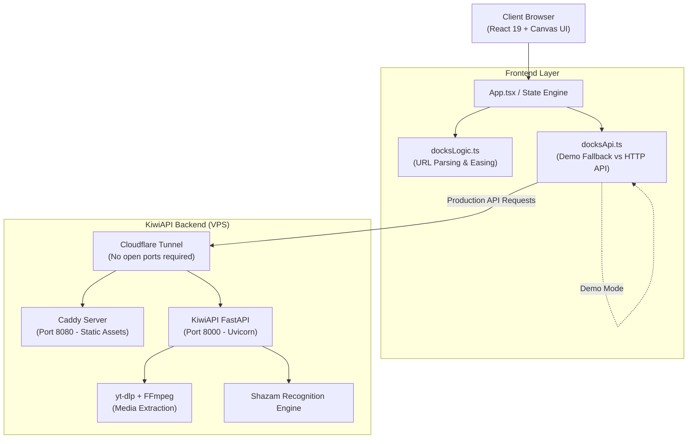

# 🥝 KiwiDL (KiwiAPI)

> A modern, multi-platform media downloader, carousel image extractor, and song identifier featuring a nautical design and procedural canvas physics.

[](https://react.dev/)
[](https://www.typescriptlang.org/)
[](https://vitejs.dev/)
[](https://tailwindcss.com/)
[](LICENSE)

---

## 📖 Overview

**KiwiDL** (also known as *Saltwake Docks*) is a web application designed to download media, inspect metadata, extract albums/carousels, and identify background music from URLs across the web.

It operates in **two flexible modes**:
1. **Interactive Demo Mode (Zero Backend Required)**: Works right out of the box with built-in procedural SVG demo art, mock metadata generators, and simulated download flows.
2. **Production Mode (KiwiAPI)**: Connects to a self-hosted FastAPI + `yt-dlp` backend for real downloads, audio extraction, and Shazam song recognition.

---

## ✨ Features

- 🎬 **Video Downloader**: Download YouTube videos/shorts, Instagram Reels, and Pinterest clips in multiple resolutions (1080p, 720p, 480p).
- 🎵 **Audio Extraction**: Strip and convert audio into MP3 (up to 320 kbps), M4A (256/128 kbps), or OPUS (160 kbps).
- 🖼️ **Post & Carousel Grabber**: Extract multi-image galleries, Instagram carousels, and Pinterest high-res plates with individual card downloads.
- 🔍 **Song Identification**: Identify songs in video clips or uploaded audio files with title, artist, cover art, and direct Shazam links.
- 🌊 **Procedural Ocean Physics**: Custom Canvas engine rendering sine wave geometry, shoreline animations, parallax sailing ships, and interactive treasure chests.
- 🛡️ **Zero-Exposure VPS Deployment**: Includes turnkey production deployment with **Caddy**, **Cloudflare Tunnel**, and automated `yt-dlp` update routines.

---

## 🏗️ Architecture



---

## 📁 Repository Structure

```text
kiwidl/
├── deploy/                     # VPS production deployment assets
│   ├── Caddyfile               # Caddy web server configuration
│   ├── cloudflared-config.yml  # Cloudflare Tunnel routing definition
│   ├── cleanup-tmp.service     # Systemd service for clearing temp downloads
│   ├── cleanup-tmp.timer       # Systemd timer (every 15 min)
│   ├── deploy.sh               # Rsync-based rapid deployment script
│   ├── kiwiapi.service         # Systemd service unit for KiwiAPI FastAPI
│   ├── setup.sh                # Server initialization script (Ubuntu 24.04)
│   ├── update-ytdlp.service    # Auto-updater for yt-dlp binaries
│   ├── update-ytdlp.timer      # Daily update schedule for yt-dlp
│   └── README-DEPLOY.md        # Detailed VPS setup & deployment guide
├── public/                     # Static icons, vector art, and assets
├── src/
│   ├── components/             # Reusable React components
│   │   ├── Icons.tsx           # SVG platform icons (YouTube, IG, Pinterest, etc.)
│   │   ├── ResultCard.tsx      # Media inspection & download action card
│   │   └── SeaBand.tsx         # Canvas-based wave animation component
│   ├── lib/
│   │   ├── docksApi.ts         # API client & Demo mock data generator
│   │   ├── docksLogic.ts       # Platform regex, URL detection & physics formulas
│   │   └── docksLogic.test.ts  # Node.js native unit tests
│   ├── App.tsx                 # Main application view & tab state machine
│   ├── index.css               # Tailwind CSS rules & custom nautical design tokens
│   └── main.tsx                # React root mount
├── .env.example                # Sample environment variables
├── package.json                # Project dependencies and script runner
├── tsconfig.json               # TypeScript compiler options
└── vite.config.ts              # Vite bundling & plugin configuration
```

---

## 🚀 Quickstart & Local Development

### Prerequisites

- **Node.js** (v18.0.0 or higher recommended, tested on v20 & v24)
- **npm** (v9.0.0 or higher)

### 1. Clone the Repository

```bash
git clone https://github.com/Sangamlabs/kiwidl.git
cd kiwidl
```

### 2. Install Dependencies

```bash
npm install
```

### 3. Environment Configuration

Copy the example environment file:

```bash
cp .env.example .env.local
```

| Variable | Description | Default / Example |
|---|---|---|
| `VITE_API_BASE` | URL of the KiwiAPI backend. **Leave empty to run in Demo Mode**. | `""` or `https://api.kiwiapi.net` |
| `VITE_API_KEY` | Key passed in `X-API-Key` header for authenticated endpoints. | `""` or `your_secret_api_key` |
| `GEMINI_API_KEY` | Optional: Gemini API key if using AI Studio features. | `""` |
| `APP_URL` | Canonical app URL for previews and callbacks. | `http://localhost:3000` |

> 💡 **Tip**: When `VITE_API_BASE` is omitted or empty, KiwiDL automatically launches in **Demo Mode**, generating sample waveforms, plates, and mock downloads without needing any server running!

### 4. Run Development Server

```bash
npm run dev
```

Visit [http://localhost:3000](http://localhost:3000) in your browser.

---

## 🧪 Testing and Linting

KiwiDL includes native unit tests for platform detection, wave interpolation, and easing calculations:

```bash
# Run unit tests with Node test runner
npm test

# Run TypeScript type check
npm run lint
```

---

## 🔌 KiwiAPI Backend Specification

When `VITE_API_BASE` is configured, KiwiDL expects the backend server to fulfill the following endpoints:

### 1. `POST /v1/info`
Inspects a media link and returns details and available formats.
- **Request Body**: `{"url": "https://..."}`
- **Response**:
  ```json
  {
    "title": "Video Title",
    "author": "Channel or User",
    "duration": "03:45",
    "thumbnail": "https://.../thumb.jpg",
    "video": [
      { "label": "1080p MP4", "size": "45 MB" },
      { "label": "720p MP4", "size": "22 MB" }
    ],
    "audio": [
      { "label": "MP3 320 kbps", "size": "8 MB" }
    ],
    "images": []
  }
  ```

### 2. `POST /v1/jobs`
Dispatches a background download/transcoding job.
- **Request Body**: `{"url": "https://...", "type": "video", "quality": "1080p MP4"}`
- **Response**: `{"job_id": "abc123xyz"}`

### 3. `GET /v1/jobs/{job_id}`
Polls job progress.
- **Response**: `{"status": "pending" | "done" | "failed"}`

### 4. `GET /v1/files/{job_id}`
Returns the binary download file once `status == "done"`.

### 5. `POST /v1/recognize`
Identifies music from a form upload or video URL.
- **Payload**: `FormData` containing `url` or file blob `file`.
- **Response**:
  ```json
  {
    "found": true,
    "artist": "Artist Name",
    "title": "Song Title",
    "cover": "https://.../cover.jpg",
    "shazam_url": "https://www.shazam.com/..."
  }
  ```

---

## 🌐 Production VPS Deployment

The `deploy/` directory provides a turnkey configuration for **Ubuntu 24.04**:

### Architecture Highlights
- **Zero Open Ports**: Only SSH (Port 22) is open on UFW; external requests are tunneled through `cloudflared`.
- **Caddy Reverse Proxy**: Serves compiled static frontend files and caches assets.
- **FastAPI / Uvicorn Service**: Runs under a restricted system user `kiwi` with sandboxed filesystem permissions.
- **Automatic yt-dlp Upgrades**: Systemd timer automatically runs nightly upgrades to prevent broken YouTube extractors.
- **Automated Temp Cleanup**: Deletes completed media files older than 30 minutes from `/var/lib/kiwiapi/tmp`.

### Deployment Steps

1. **Provision VPS**: Ubuntu 24.04 (2 vCPU, 4 GB RAM recommended).
2. **Configure Cloudflare Tunnel**: Add your domain to Cloudflare and authenticate `cloudflared`.
3. **Execute Server Setup**:
   ```bash
   ssh user@your-server
   sudo bash /opt/kiwiapi/deploy/setup.sh
   ```
4. **Deploy Application Updates**:
   From your local development machine:
   ```bash
   bash deploy/deploy.sh user@your-server
   ```

Refer to [deploy/README-DEPLOY.md](deploy/README-DEPLOY.md) for the complete, step-by-step production handbook.

---

## 🛠️ Troubleshooting

| Issue | Cause | Solution |
|---|---|---|
| **Downloads stuck in "Preparing"** | Backend `yt-dlp` extractor outdated. | Run `sudo systemctl start update-ytdlp.service` on the backend VPS. |
| **CORS Error in Browser** | Backend `ALLOWED_ORIGINS` does not match frontend origin. | Update `/opt/kiwiapi/.env` on the server with your frontend URL. |
| **Demo mode active in production** | `VITE_API_BASE` is empty or missing in build environment. | Set `VITE_API_BASE=https://api.yourdomain.com` and run `npm run build`. |
| **Song recognition returns "No match"** | Background audio has heavy dialogue or is under 5 seconds. | Use a clearer audio segment with minimal vocal background overlap. |

---

## 📄 License

This project is licensed under the [MIT License](LICENSE).
